<div align="center">

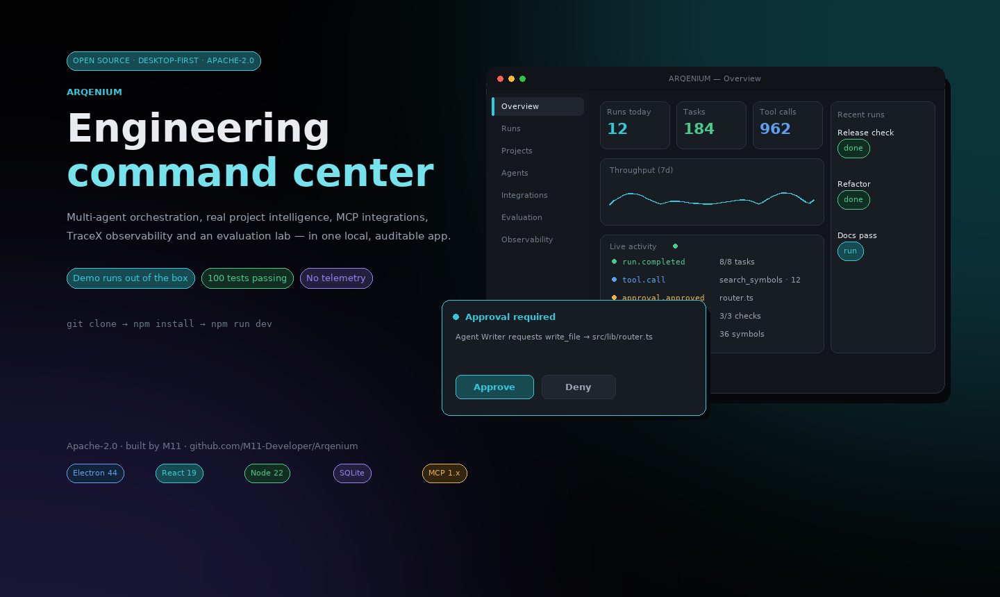

# ARQENIUM

**A local, desktop-first engineering command center.**
Multi-agent orchestration · real project intelligence · MCP integrations · TraceX observability · evaluation lab.

`v1.0.0` · Apache-2.0 · Electron 44 · React 19 · Node 22 · SQLite · MCP 1.x

[Quick start](#quick-start) · [Tour](#the-interface) · [Tutorial](docs/TUTORIAL.md) · [Architecture](docs/ARCHITECTURE.md) · [Security](SECURITY.md) · [Videos](docs/video)

</div>

---

## What it is

ARQENIUM is a desktop application that indexes a repository **on your machine**, runs multi-agent engineering tasks against it through **approval-gated tools**, records every decision in **TraceX**, and lets you **evaluate** the result. Nothing leaves the machine unless you configure a provider yourself — and every capability works offline out of the box, because a deterministic **demo provider** ships built in.

It is not a chat window with a file tree attached. It is an operations console: work is composed as **runs** of **tasks**, agents have explicit **tool grants and permission flags**, writes and commands stop at an **approval prompt**, and the whole session is auditable.

```
git clone https://github.com/M11-Developer/Arqenium.git
cd Arqenium
npm install
npm run dev          # UI http://localhost:5173 · API http://127.0.0.1:4319
```

No account. No sign-up. No telemetry.

## Install on Windows

Grab the latest [release](https://github.com/M11-Developer/Arqenium/releases/latest):

| Asset | What it is |
| --- | --- |
| `ARQENIUM-<version>-win-x64-setup.exe` | Installer (per-user, no admin rights, desktop + Start-menu shortcuts) |
| `ARQENIUM-<version>-win-x64-portable.exe` | Portable single executable |
| `SHA256SUMS.txt` | Verify with `Get-FileHash .\ARQENIUM-*.exe -Algorithm SHA256` |

The builds are unsigned: SmartScreen shows "Windows protected your PC" on first run — **More info → Run anyway**. Windows 10 1809+ / 11, x64.

Installers are produced by the [`Windows`](.github/workflows/windows.yml) workflow on a real Windows runner for every `v*` tag, after typecheck, lint, the full test suite and a built-API smoke test pass there.

## Quick start

| Step | Command | Result |
| --- | --- | --- |
| 1. Install | `npm install` | Dependencies only; no global tooling required |
| 2. Develop | `npm run dev` | Vite UI on **5173**, local API on **4319**, `/api` proxied |
| 3. Build | `npm run build` | `dist/` — server, core, electron main/preload and renderer |
| 4. Run built app | `npm run serve` | Single process serving UI + API on **4319** |
| 5. Desktop dev | `npm run dev:desktop` | Vite + API + Electron shell, same command on every OS |
| 6. Package | `npm run dist` | Installers in `release/` (NSIS + portable on Windows) |
| 7. Verify | `npm test` | 118 tests across 11 suites |

Run the built server on another port with `ARQ_API_PORT=4400 ARQ_STATIC_DIR=dist/renderer node dist/server/main.js` (PowerShell: `$env:ARQ_API_PORT='4400'`).

### Windows

ARQENIUM runs natively on Windows 10/11 — it is not a POSIX app with a shim bolted on:

- **Paths** go through [`src/core/paths.ts`](src/core/paths.ts), which compares case-insensitively on Windows and macOS and is separator-aware, so `C:\work\proj` and `c:\WORK\PROJ` are the same project while `C:\work\proj-evil` never is. Source viewing, the static file server and EchoShell's working directory all use it, so traversal is refused the same way on every OS.
- **Child processes** never rely on a shell. `npm`, `npx`, `git`, `python` and friends are resolved through `PATH` × `PATHEXT` (`.exe`, `.cmd`, `.bat`, `.com`), because Windows has no execute bit and `spawn('npm')` fails with `ENOENT` there.
- **No console flicker**: git, python and every spawned tool run with `windowsHide`.
- **CRLF is expected**: git porcelain output, file reads and diffs are split on `\r?\n`.
- **Data lives in `%APPDATA%\Arqenium`**, not a dotfile in the home directory.
- **Shutdown is platform-correct**: the dev runner uses `taskkill /T /F` on Windows so `Ctrl+C` does not orphan Vite or Electron.

The [`Windows`](.github/workflows/windows.yml) workflow runs typecheck, lint, the full test suite, the built-API smoke test and an installer build on `windows-latest` for every push, so this stays true.

Requirements: **Node ≥ 22.12**, npm ≥ 10. `better-sqlite3` compiles a native module — if your machine ships a non-standard Node build, set `npm_config_nodedir=/usr/local` before installing.

The desktop shell (`npm start`) needs the Electron runtime binary. If that download is blocked in your environment (CI sandboxes, restricted networks), use the web runtime — `npm run dev` or the built static server — which exposes exactly the same UI and API contract over loopback. See [Architecture → runtimes](docs/ARCHITECTURE.md#runtimes).

## The interface

Eleven destinations, grouped into **Workspace** and **System**, with a top bar that carries the page breadcrumb, the active-project switcher and index status. Every control maps to a validated backend channel — there are no decorative buttons.

<table>
<tr>
<td width="50%">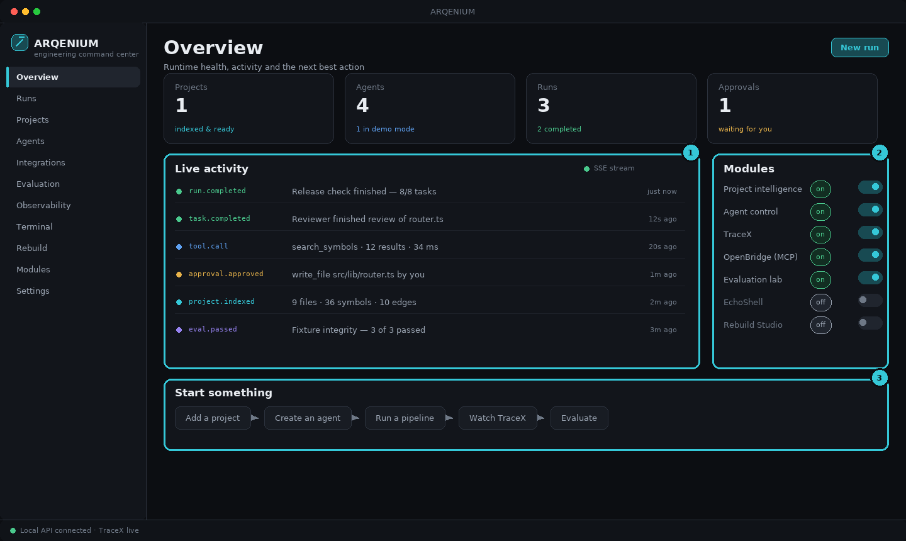<br /><b>Overview</b> — health, recent runs, pending approvals, capability status.</td>
<td width="50%">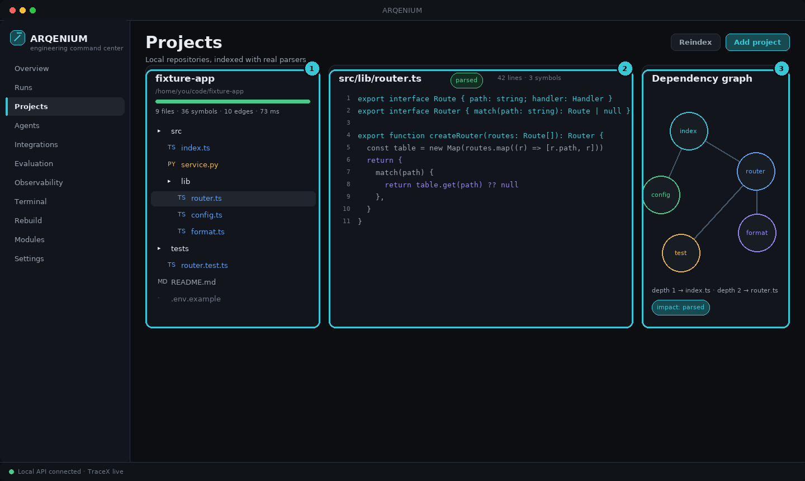<br /><b>Projects</b> — tree, source, parsed symbols, dependency graph, impact analysis.</td>
</tr>
<tr>
<td>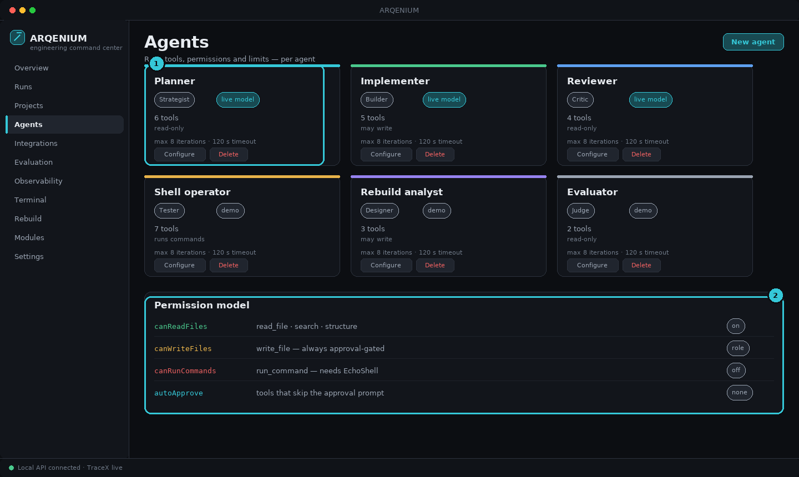<br /><b>Agents</b> — role, prompt, tool grants, permission flags, limits.</td>
<td>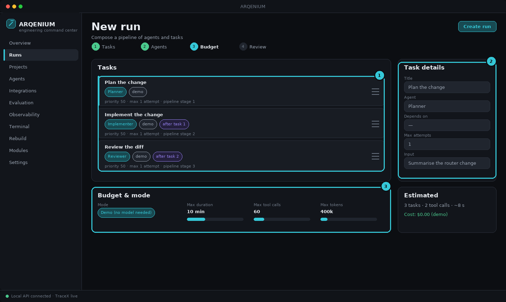<br /><b>Runs</b> — compose a pipeline of tasks, set budgets, watch it, approve it.</td>
</tr>
<tr>
<td>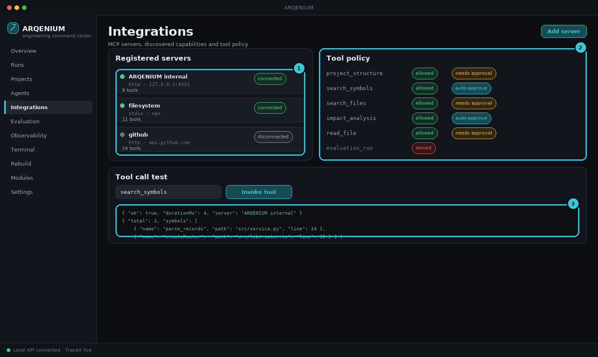<br /><b>Integrations</b> — MCP servers, discovered capabilities, per-tool policy.</td>
<td>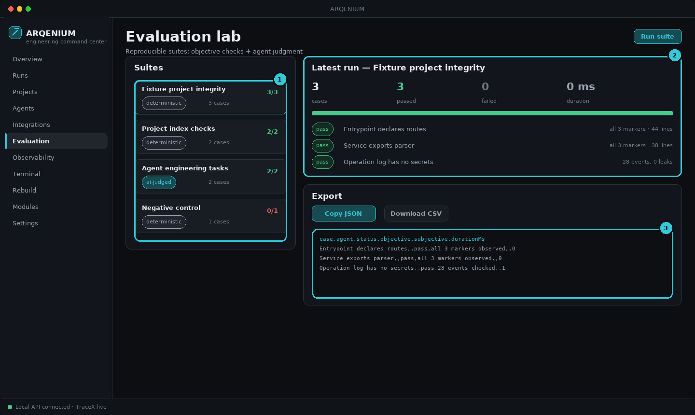<br /><b>Evaluation lab</b> — reproducible suites, JSON/CSV export, re-runs.</td>
</tr>
<tr>
<td>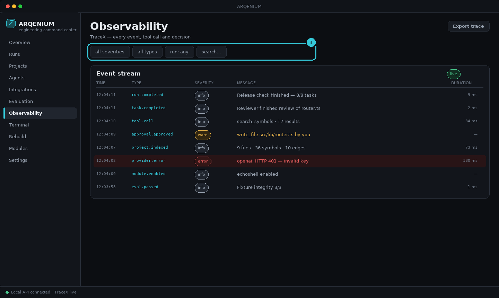<br /><b>Observability</b> — TraceX: every event, tool call and approval.</td>
<td>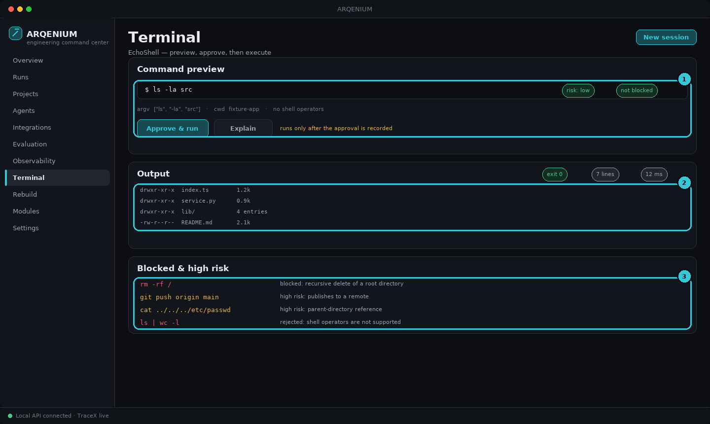<br /><b>Terminal</b> — EchoShell: preview, approve, execute; no shell operators.</td>
</tr>
<tr>
<td>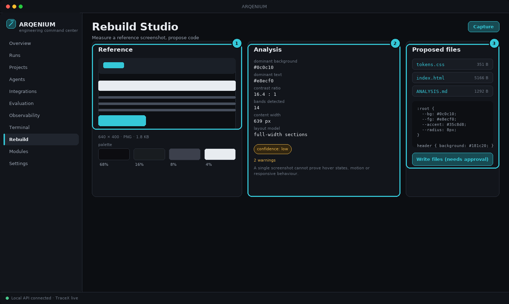<br /><b>Rebuild Studio</b> — screenshot → measured facts → proposed code.</td>
<td>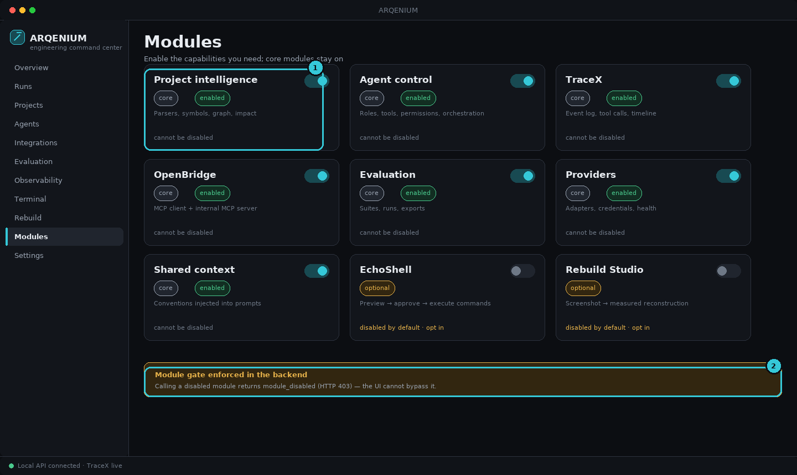<br /><b>Modules</b> — enable optional capabilities; the gate is server-side.</td>
</tr>
</table>

Full walkthrough of every screen, button, field and option: **[docs/TUTORIAL.md](docs/TUTORIAL.md)**.
System design, data model and security boundaries: **[docs/ARCHITECTURE.md](docs/ARCHITECTURE.md)**.

## Video walkthrough

Five narrated episodes, 1440×800, covering every surface end to end. Files live in [`docs/video/`](docs/video) and are linked from the [v1.0.0 release](https://github.com/M11-Developer/Arqenium/releases/tag/v1.0.0).

| Episode | Covers | Length |
| --- | --- | --- |
| [`01-install-and-tour.mp4`](docs/video/01-install-and-tour.mp4) | Install, launch, the shell, all eleven destinations, live data | 0:38 |
| [`02-projects-and-intelligence.mp4`](docs/video/02-projects-and-intelligence.mp4) | Add a project, indexing, tree/source/symbols, impact analysis | 0:30 |
| [`03-agents-and-permissions.mp4`](docs/video/03-agents-and-permissions.mp4) | Agent library, role templates, tool grants, permission flags | 0:28 |
| [`04-create-and-run-a-pipeline.mp4`](docs/video/04-create-and-run-a-pipeline.mp4) | Task composition, budgets, live progress, approvals | 0:34 |
| [`05-every-other-surface.mp4`](docs/video/05-every-other-surface.mp4) | MCP + tool policy, evaluation, EchoShell, Rebuild, Modules, Settings | 0:41 |

## What actually works

Everything below is implemented in this repository and covered by the test suite. Nothing here is a mock or a placeholder.

**Project intelligence**
- Local indexing of TypeScript/JavaScript via the TypeScript compiler API and Python via a sandboxed child-process parser; other languages fall back to structural scanning and are labelled `approximate`.
- File tree, per-file summaries, source viewing with a binary probe, parsed symbol table and symbol search.
- Import graph and impact analysis. **Parsed** edges and **heuristic** test matches are kept distinct — the UI never presents a guess as a fact.
- `.gitignore`-aware exclusion rules, so `node_modules`, build output and secrets stay out of the index.

**Orchestration**
- Runs are DAGs of tasks with `dependsOn`, per-task priority, retry policy and a pipeline of agents; each agent receives the previous agent's output.
- Hard budgets — wall-clock, tool calls, tokens, task count — enforced by the engine; exceeding one fails the run and records why.
- Streaming progress over one SSE channel, persisted as TraceX events.
- Cancellation that stops scheduling and marks in-flight tasks.

**Agents & permissions**
- Agents are configuration: role, system prompt, model ref, tool grants, `canReadFiles` / `canWriteFiles` / `canRunCommands` / `autoApprove`, iteration limits.
- Least privilege by default. Writes always produce an approval record; denials are returned to the agent as `denied` with an instruction not to retry.

**Integrations**
- MCP client over **stdio** and **Streamable HTTP**, with tool discovery, per-tool allow/deny/ask/auto policy, result caps and call results surfaced in the UI.
- An **internal MCP server** exposes ARQENIUM's own project-intelligence tools to external MCP clients.

**Observability**
- TraceX records `run.*`, `task.*`, `tool.call`, `approval.*`, `project.*`, `eval.*`, `terminal.*`, `mcp.*` events with severity, correlation ids and durations.
- Filters by free text, severity and event type; tool-call tab; JSON export.

**Evaluation**
- Built-in deterministic suites that run offline against a bundled fixture, plus AI-judged cases when an agent is selected.
- Objective checks and model judgment are reported separately; no benchmark score is claimed.
- JSON and CSV export, re-run with the same configuration.

**EchoShell** *(optional module, off by default)*
- Commands are parsed to an **argv array and executed without a shell** — pipes, redirection and chaining are rejected outright.
- Static risk assessment (`low`/`medium`/`high`) with reasons; a hard blocklist no approval can unlock (`rm -rf /`, fork bombs, `mkfs`, raw device writes, power-state changes).
- Preview → approve → execute, with output capture and redaction of fixture secrets.

**Rebuild Studio** *(optional module, off by default)*
- Capture a screenshot file or fetch a page, measure palette, bands, spacing and typography, and propose files.
- **Measured facts** and **inferred design tokens** are presented in separate groups, with warnings and a confidence label.

## Configuration

Environment variables (see [`.env.example`](.env.example)) are an optional fallback for headless use. In the desktop app, credentials are stored encrypted and managed from **Settings → Credentials**.

| Variable | Default | Purpose |
| --- | --- | --- |
| `ARQ_API_PORT` | `4319` | Local API port |
| `ARQ_DATA_DIR` | `~/.arqenium` (Linux: `~/.local/share/arqenium`) | SQLite database and artifacts |
| `ARQ_STATIC_DIR` | — | Serve a built renderer from the API process |
| `ARQ_DEMO_MODE` | `0` | Hosted preview: in-memory database plus a seeded sample project |
| `ARQ_OPENAI_API_KEY` / `ARQ_ANTHROPIC_API_KEY` / `ARQ_GEMINI_API_KEY` | — | Provider keys (optional) |
| `ARQ_OPENAI_BASE_URL` · `ARQ_OLLAMA_HOST` | — | OpenAI-compatible and local endpoints |
| `ARQ_TELEMETRY` | `0` | Accepted but inert: the app has no telemetry backend |

Providers supported out of the box: OpenAI, OpenAI-compatible endpoints, Anthropic, Gemini, Ollama, and the built-in **demo** provider. Adding another vendor means implementing one adapter — see [ARCHITECTURE.md](docs/ARCHITECTURE.md#adding-a-provider).

## Repository layout

```
src/
  shared/        channels (zod contracts), types, events, ids, catalog
  core/          db, dispatcher, agents, approvals, context, credentials,
                 modules, providers/, projects/ (+lang parsers), orchestration/,
                 mcp/ (client + internal server), evals/, terminal/, traces/,
                 rebuild/, redact, settings
  server/        local HTTP API (POST /api/invoke, GET /api/events)
  electron/      main + preload (contextIsolation, typed IPC bridge)
  renderer/      12 pages, shell, ui primitives, theme
tests/           9 suites, 100 tests, fixture repository
docs/            tools/ (renderer), images/ (stills), video/ (walkthroughs)
scripts/         build.mjs, dev.mjs
```

## Development

```bash
npm test            # 100 tests
npm run typecheck   # tsc --noEmit
npm run lint        # eslint
npm run build       # esbuild + vite
python3 docs/tools/stills.py   # regenerate documentation stills
python3 docs/tools/videos.py   # regenerate walkthrough videos
```

Documentation imagery is generated deterministically from the design tokens in `src/renderer/styles/theme.css`, so it can be rebuilt without a browser. See [CONTRIBUTING.md](CONTRIBUTING.md).

## Honest limits

- **Model quality is the model's.** ARQENIUM provides the orchestration, sandboxing, approvals and audit trail; it does not make a model correct.
- **Demo output is labelled.** With no provider configured, runs execute against the deterministic demo adapter and say so in the UI and in TraceX. Those strings are samples, not model output.
- **Python parsing is structural.** The TypeScript adapter uses the real compiler API; the Python adapter extracts definitions and imports with a syntax-aware scanner and reports `parseQuality` honestly.
- **EchoShell is not a shell.** Argument vectors only. That is a deliberate safety property, not a missing feature.
- **The hosted preview is a preview.** The Vercel deployment serves the real renderer over a captured sample dataset and refuses every mutation. Indexing, models, MCP, EchoShell and approvals only run in the desktop app.
- **Electron packaging needs the runtime binary.** `npm run pack:dir` / `npm run dist` are configured but require `electron` to be downloadable; the Windows workflow builds the installers on a real Windows runner.

## Hosted preview

The [Vercel deployment](https://arqenium.vercel.app) is a **static, read-only preview** of the interface, not a hosted backend. Vercel functions cannot host the core — it needs a writable SQLite database, long-lived SSE connections and native modules — so the deployed page loads [`public/preview-bridge.js`](public/preview-bridge.js), which answers the UI's channels from an in-browser sample dataset and refuses every mutating channel with an explicit "read-only" error. Parsing, indexing, orchestration and EchoShell genuinely do not run there.

The bridge only installs when `GET /api/info` does not return JSON, so `npm run dev`, `npm run serve` and the Electron app always talk to the real core. On a real host, demo mode (`ARQ_DEMO_MODE=1`) seeds an in-memory database with a sample project and indexes it for real - that path is exercised by `npm test`.

Deployment steps, the required project settings and the one setting that makes a deployment public are in [docs/DEPLOY.md](docs/DEPLOY.md). Live: **https://arqenium-demo.vercel.app**

## License

Apache-2.0 © Mohamed El-Sayed Abdelfatah (M11). See [LICENSE](LICENSE).
